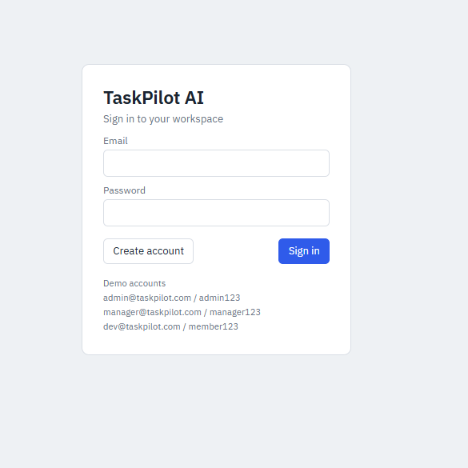
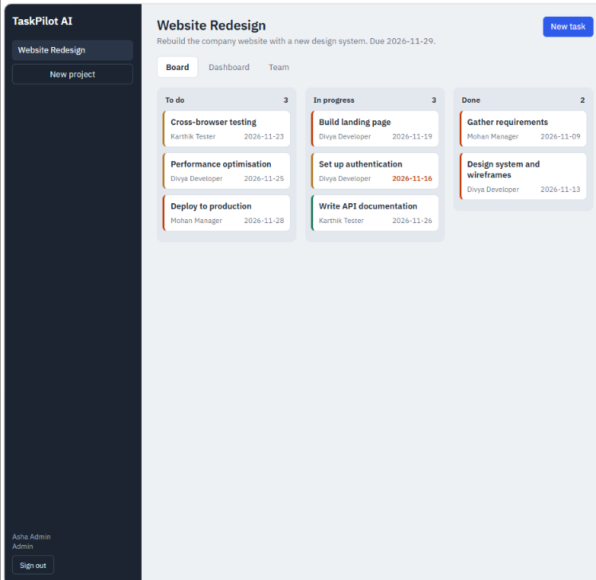
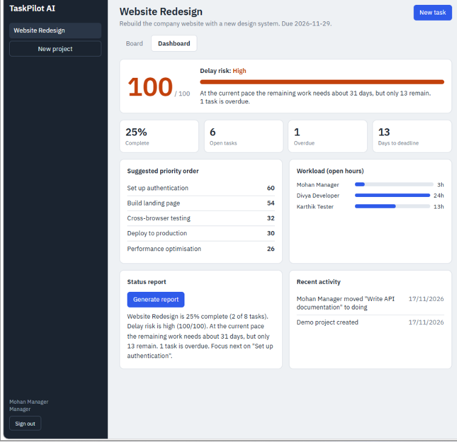
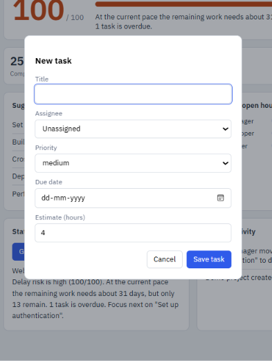
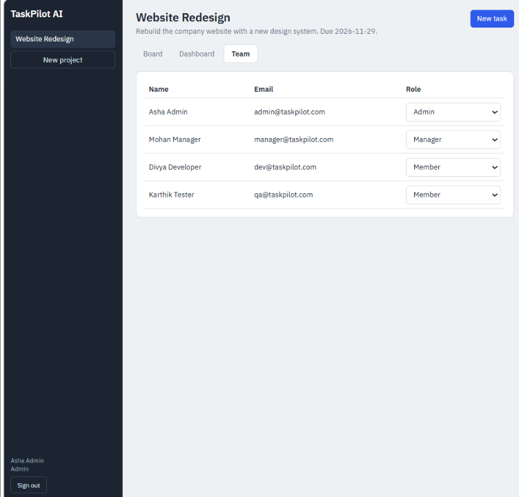
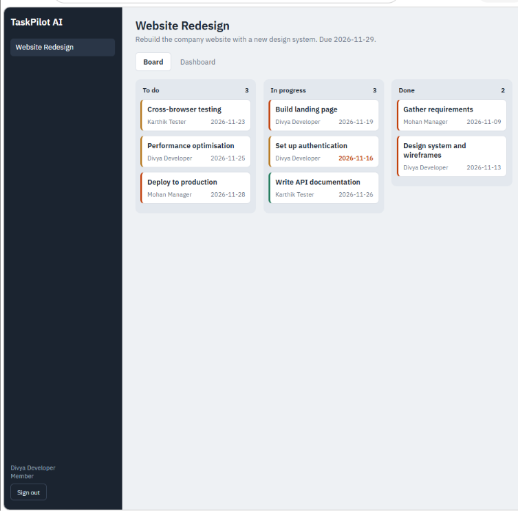
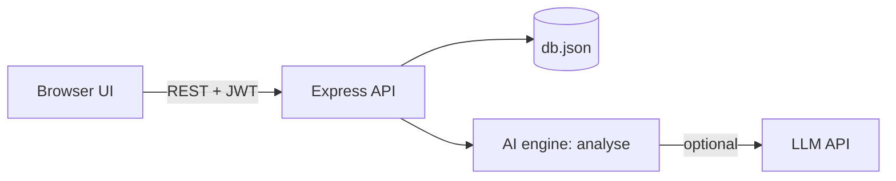

<div align="center">


# TaskPilot AI

**Know which project will slip before it does.**

An intelligent project management and predictive analytics dashboard with AI delay-risk scoring, smart task priorities and workload insight.


[**Live demo**](https://YOUR-APP.onrender.com) | [Features](#-features) | [Screenshots](#-screenshots) | [Quick start](#-quick-start) | [Deploy](#-deploy-on-render)

</div>

---

## 📌 Overview

Project teams miss deadlines because problems show up too late. **TaskPilot AI** watches how fast work is really getting done and warns managers early: which project is at risk, which task to pick up next, and who is overloaded.

## ✨ Features

| | Feature | Description |
|---|---|---|
| 🎯 | **Delay-risk prediction** | A live 0-100 score with plain-language reasons, shown on an animated dial |
| 🧠 | **Smart priorities** | Open tasks ranked by priority and urgency |
| 📊 | **Workload insight** | Open hours per team member at a glance |
| 📝 | **AI status report** | One-click weekly report; written by an LLM when an API key is set, otherwise generated from rules |
| 🗂️ | **Kanban board** | Drag and drop tasks between To do, In progress and Done, with search |
| 🔐 | **Role-based access** | Admin, Manager and Member permissions with JWT authentication |
| 🔔 | **Activity feed** | Recent changes and automatic refresh every 20 seconds |
| 📱 | **Responsive design** | Works on phones, tablets and desktops |

## 🖼️ Screenshots

<table>
  <tr>
    <td align="center"><b>🔑 Sign in</b><br></td>
    <td align="center"><b>🗂️ Kanban board</b><br></td>
  </tr>
  <tr>
    <td align="center"><b>📊 AI dashboard</b><br></td>
    <td align="center"><b>➕ New task</b><br></td>
  </tr>
  <tr>
    <td align="center"><b>👥 Team management</b><br></td>
    <td align="center"><b>🔒 Member view (limited access)</b><br></td>
  </tr>
</table>

## 🛠️ Tech stack

| Layer | Technology |
|---|---|
| Frontend | HTML, CSS, vanilla JavaScript (no framework) |
| Backend | Node.js, Express |
| Authentication | JWT, bcryptjs |
| Storage | JSON file (`db.json`) |
| AI | Rule-based analytics engine; optional Anthropic API for reports |
| Hosting | Render |

## 🏗️ Architecture



## 🧮 How the AI engine works

The `analyse()` function in `server.js` calculates:

1. **Velocity**: tasks completed per day since the project started.
2. **Days needed**: open tasks divided by velocity.
3. **Risk score (0-100)**: days needed compared with days left to the deadline, plus a penalty for overdue tasks.
4. **Priority score**: task priority weight plus an urgency bonus that grows as the due date approaches.
5. **Workload**: sum of estimated hours of open tasks per person.

| Score | Level |
|---|---|
| 0-34 | 🟢 Low |
| 35-64 | 🟡 Medium |
| 65-100 | 🔴 High |

## 👥 Roles

| Action | Admin | Manager | Member |
|---|:---:|:---:|:---:|
| View board and dashboard | ✅ | ✅ | ✅ |
| Move own tasks | ✅ | ✅ | ✅ |
| Create projects and tasks | ✅ | ✅ | ❌ |
| Edit or delete any task | ✅ | ✅ | ❌ |
| Change user roles | ✅ | ❌ | ❌ |

## 🚀 Quick start

```bash
git clone https://github.com/YOUR-USERNAME/taskpilot-ai.git
cd taskpilot-ai
npm install
npm start
```

Open **http://localhost:3000**. Requires Node.js 18 or newer.

### Demo accounts

| Role | Email | Password |
|---|---|---|
| Admin | admin@taskpilot.com | admin123 |
| Manager | manager@taskpilot.com | manager123 |
| Member | dev@taskpilot.com | member123 |

### Environment variables (optional)

| Variable | Purpose |
|---|---|
| `JWT_SECRET` | Secret used to sign login tokens. Set your own in production |
| `ANTHROPIC_API_KEY` | Enables AI-written status reports |
| `PORT` | Server port (default 3000) |

## ☁️ Deploy on Render

1. Push this repository to GitHub.
2. On [render.com](https://render.com), choose **New > Web Service** and connect the repository.
3. Use these settings: Runtime **Node**, Build command `npm install`, Start command `npm start`.
4. Under **Environment**, add `JWT_SECRET` with a long random value.
5. Click **Create Web Service**. Your app goes live at `https://<name>.onrender.com`.

A `render.yaml` blueprint is included for one-click setup.

> **Note:** On Render's free plan the disk is temporary, so data in `db.json` resets when the service restarts or redeploys. The demo accounts are recreated automatically. For permanent data, move storage to a database such as PostgreSQL or MongoDB Atlas.

## 📁 Project structure

```
taskpilot-ai/
├── public/index.html      # Frontend (UI, board, dashboard)
├── server.js              # API, auth and AI engine
├── render.yaml            # Render deployment blueprint
├── docs/                  # Logo and screenshots
├── .env.example
└── package.json
```

## 🗺️ Roadmap

- [ ] PostgreSQL or MongoDB storage
- [ ] Charts with Chart.js
- [ ] Real-time notifications (WebSockets)
- [ ] Task comments and file attachments
- [ ] Automated tests and Docker support

## 📄 License

Released under the MIT License.

<div align="center">Built with ❤️ for the Open Innovation project</div>
